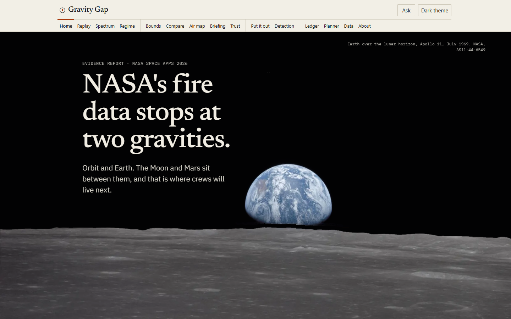
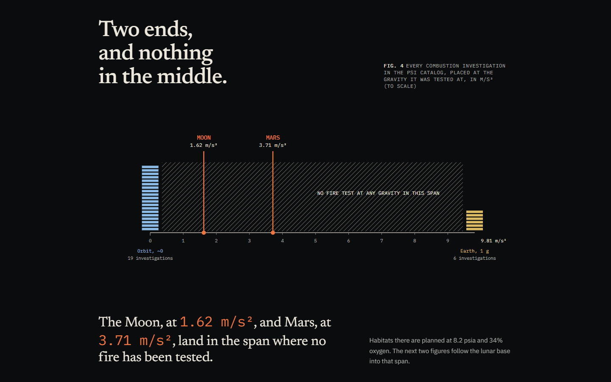
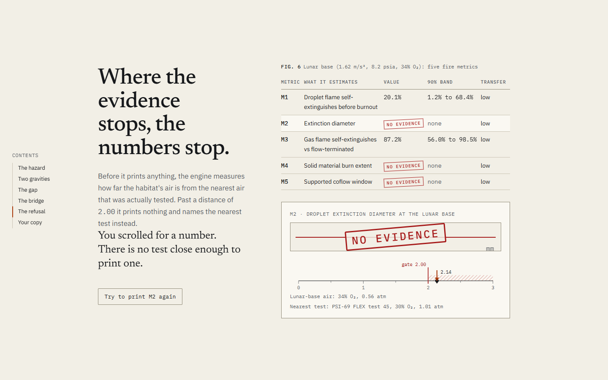
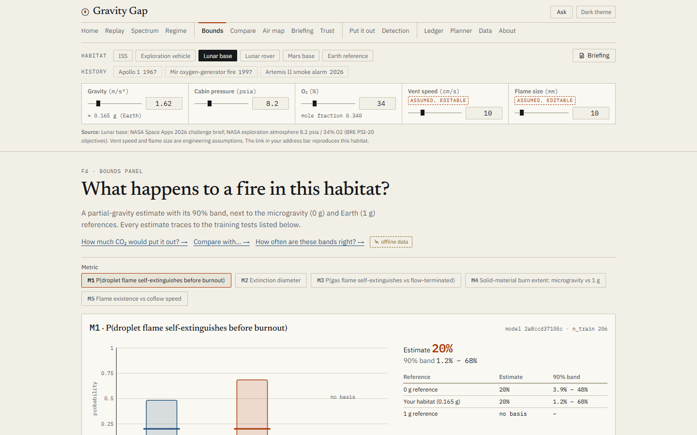
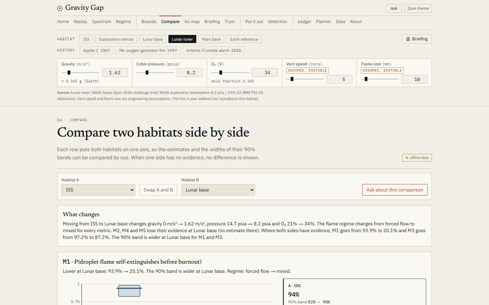
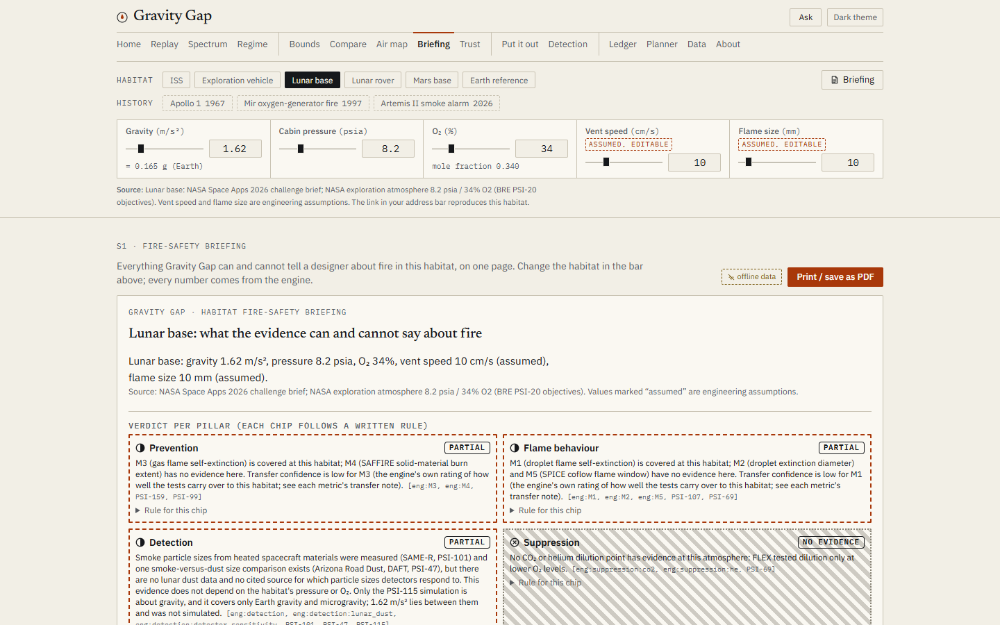
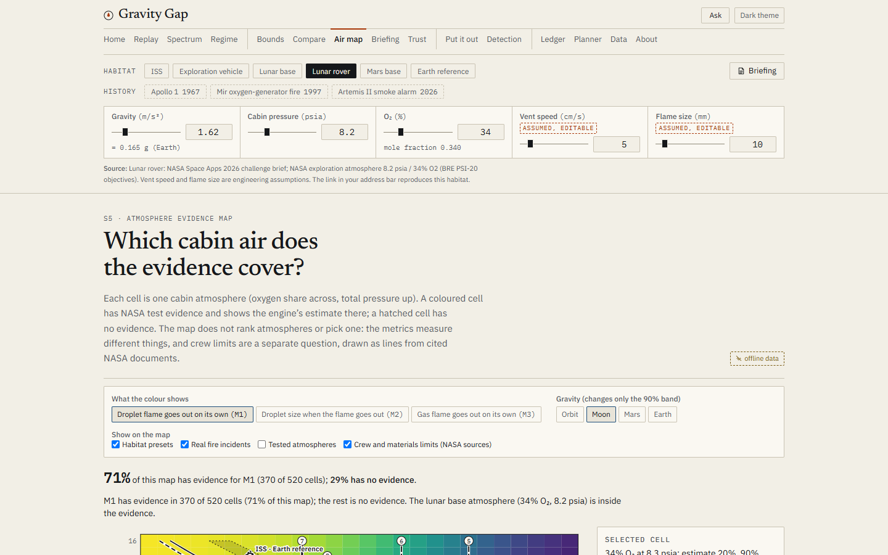

# Gravity Gap

**Live site: [nasa-hackathon-2026-two.vercel.app](https://nasa-hackathon-2026-two.vercel.app/)** · built for the 2026
NASA Space Apps Challenge (AI-powered fire safety dashboard for NASA microgravity combustion data).

> NASA has fire data from orbit and from Earth, but none from the Moon or Mars, where crews will live next.
> Gravity Gap uses physics and 1,710 real NASA combustion tests to predict how a fire would behave in a lunar or
> Martian habitat, shows how sure it is, and refuses to give a number where the evidence runs out.



## What it does, briefly
Every fire test in NASA's Physical Sciences Informatics (PSI) archive burned at one of two gravities: orbit (about
0 g) or Earth (1 g). The Moon (1.62 m/s²) and Mars (3.71 m/s²) sit in the gap between them, with planned habitat air
of 8.2 psia and 34% oxygen that NASA has barely tested. Gravity Gap:

1. **Picks up the habitat you care about** (ISS, lunar base, Mars base, or your own gravity, pressure, oxygen and
   vent speed).
2. **Works out the flame physics** there: how strongly the flame's own buoyancy competes with the cabin fan.
3. **Carries the nearest NASA test evidence across the gap** and gives an estimate with a 90% band that widens to pay
   for the gravity difference.
4. **Says "no evidence" instead of guessing** when the habitat's air is too far from anything NASA tested, and names
   the nearest test.
5. **Tells you what to test next,** checks itself by hiding real tests (`/trust`), and puts it all on a one-page,
   printable fire-safety briefing per habitat.

An AI assistant answers questions about any result, but every number it says is checked against the engine and every
claim must cite a NASA test or engine output.

| | |
|---|---|
|  |  |
| **The gap.** Every PSI combustion investigation on a gravity axis; the Moon and Mars land where no fire has been tested. | **The refusal.** At the lunar base the engine prints M1 and M3, but stamps "no evidence" on M2, M4 and M5. |
|  |  |
| **Bounds.** Estimate, 90% band, and the 0 g and 1 g references it came from. | **Compare.** Two habitats side by side, with a plain "what changes" summary. |
|  |  |
| **Briefing.** A printable verdict per fire-safety pillar, key numbers, gaps and next tests. | **Air map.** Which cabin atmospheres NASA's evidence covers, with NASA crew limits drawn from cited sources. |

## Pages
Pick a habitat in the bar at the top and every page updates (the habitat is kept in the URL, e.g.
`?g=1.62&p=8.2&o2=0.34&u=10&L=10`, g in m/s²).

| Page | What you get |
|---|---|
| `/` | The story: why the Moon and Mars fall in NASA's fire-data gap, ending with the habitat choice |
| `/replay` | Real fires (Apollo 1, Mir 1997, Artemis II smoke alarm) loaded as habitats |
| `/explore` | Every PSI investigation on a gravity axis, ranked for your habitat |
| `/regime` (`?tab=pressure`) | Buoyant velocity, Richardson number, forced / mixed / buoyant regime, pressure × gravity map |
| `/bounds` (`?metric=M1..M5`) | Estimate, 90% band, transfer confidence, what makes the band wide, evidence rows; "no evidence" when untested |
| `/compare` | Two habitats side by side |
| `/atmospheres` | Air map: where NASA's evidence covers oxygen × pressure, with cited crew limits |
| `/briefing` | One printable fire-safety page per habitat |
| `/trust` | The honesty test: how often the 90% bands held when real tests were hidden, misses included |
| `/suppression` | How CO₂ or helium dilution changed flames in NASA's FLEX tests (with safety note) |
| `/detection` | Smoke particle sizes and the gravity simulation; lunar dust stated as an open gap |
| `/ledger` | Hash-committed, append-only predictions, re-verified in the browser |
| `/planner` | The next tests NASA should run, ranked |
| `/data`, `/investigations/[id]`, Ask | Clean test data with DOI citations, investigation cards, and the cited AI assistant |

The live site runs without a backend: it serves the engine outputs saved with the build (pages show an "offline
data" chip), so the six habitat presets work everywhere; a custom habitat needs the API (see Quickstart).

## How AI was used
Gravity Gap was built with AI assistance (Anthropic's Claude, via Claude Code): it wrote most of the code, tests,
plans and documentation under the team's direction and review. The fire-safety numbers come from the engine
(physics, statistical models fitted to NASA data), not from a language model. The in-app assistant only restates
engine outputs and is validated against them. No images on the site are AI-generated: all photographs are
public-domain NASA images, credited on the page and in
[scrollcraft/builds/gravity-gap/CREDITS.md](scrollcraft/builds/gravity-gap/CREDITS.md).

Example (lunar base, 1.62 m/s², 8.2 psia, 34% O₂, vent 10 cm/s): the flame is in the **mixed** regime (Ri ≈ 6.48;
Monte Carlo 71.7% mixed / 28.3% buoyant), M1 = 0.20 with a 90% band [0.012, 0.684] and low transfer confidence, and
M2/M4/M5 return "no evidence" (`artifacts/bounds/lunar_base_M*.json`). The planner's top pick targets exactly that
atmosphere (`artifacts/planner.json`).

## Quickstart
Requirements: Python 3.13, Node 22.

```bash
# 1. API (from the repo root)
pip install -r requirements.txt
pip install -r requirements-ai.txt          # optional: live Claude answers when ANTHROPIC_API_KEY is set
python -m uvicorn api.main:app --port 8000  # docs at http://localhost:8000/docs

# 2. Web (second terminal)
cd web
npm ci
npm run dev                                 # http://localhost:3000 (copies artifacts first)
```

The web app reads `NEXT_PUBLIC_API_URL` (default `http://localhost:8000`). With the API stopped it falls back to the
precomputed artifacts for the six presets and shows an "offline data" chip. Without `ANTHROPIC_API_KEY`, Ask uses
validated cached or template answers. Docker and hosted deploys: [docs/DEPLOY.md](docs/DEPLOY.md).

## Tests
```bash
python -m pytest                 # engine, data quality, API, ledger, AI validator (repo root)
cd web && npm test               # vitest: physics parity, data layer, ledger hash, markdown safety
cd web && npm run lint
cd web && npx playwright install chromium && npm run e2e   # Playwright E2E: demo path online + offline, axe a11y
```
`npm run e2e` starts the API and `next start` itself (Playwright `webServer`); run `npm run build` first.
CI: [.github/workflows/ci.yml](.github/workflows/ci.yml).

## Rebuilding artifacts
Order matters (later steps hash or quote earlier ones):
1. **Engine artifacts:** `python -m engine.catalog`, `python -m engine.regime_grid`, `python -m engine.rules`,
   `python -m engine.bounds`, `python -m engine.planner`, `python -m engine.validation`, and (once DE lands it)
   `python -m engine.hindcast`
2. **AI cache:** `python -m engine.ai.answer --build-cache`
3. **Manifest (last):** `python scripts/build_manifest.py`, then `GET /health` must report `manifest_ok: true`.

`ledger/predictions.jsonl` is append-only: never rewrite existing lines.

## Repo map
```
api/            FastAPI app (api.main:app), schemas, API README
engine/         physics, presets, Monte Carlo, catalog, ranking, bounds models (M1–M3), rules (M4–M5),
                planner, validation, ledger, ai/ (context pack, validator, prompts, answers)
artifacts/      built outputs: catalog, regime grid, bounds/ (6 presets × 5 metrics), planner, rules,
                validation report, AI cache, MANIFEST
data/           PSI raw tables + metadata (sha256 manifest) and data/clean/ (clean tests, cleaning report)
ledger/         predictions.jsonl (append-only, hashed)
scripts/        fetch_psi, clean_psi_tables, seed_ledger, build_manifest, ledger append-only check
tests/          pytest suites + fixtures/physics_reference.json (shared with the web parity test)
web/            Next.js 15 app (app/, components/, lib/, e2e/)
docs/           SUBMISSION, DEMO_SCRIPT, DEPLOY, media/
plan/           engineering plan, contracts, decisions (ADRs), status
```

## Documentation
- Plan: start at [plan/00-overview.md](plan/00-overview.md); progress in [plan/STATUS.md](plan/STATUS.md);
  interfaces in [plan/contracts.md](plan/contracts.md); decisions in [plan/decisions.md](plan/decisions.md).
- Demo: [docs/DEMO_SCRIPT.md](docs/DEMO_SCRIPT.md) (2-minute and 30-second versions, offline fallback).
- Submission draft: [docs/SUBMISSION.md](docs/SUBMISSION.md).
- Deploy: [docs/DEPLOY.md](docs/DEPLOY.md).
- API: [api/README.md](api/README.md). Web: [web/README.md](web/README.md).
- Model validation: [artifacts/validation_report.md](artifacts/validation_report.md).
- Plan knowledge graph: `graphify-out/` (`graph.html`, `GRAPH_REPORT.md`; built with graphify from `plan/`).

## Limitations
No partial-gravity combustion data exist, so partial-g bands are a stated assumption, not a validated quantity.
Gravity does not move the droplet / burner estimates (M1–M3); it widens their bands and lowers confidence.
When a habitat atmosphere is far from every tested condition, the tool shows no number. This is decision support
for research prioritization, not a safety certification.

## Data, license and citation
Built on NASA **Physical Sciences Informatics (PSI)** combustion data, https://psi.nasa.gov, licensed **CC0-1.0**.
CC0 needs no attribution, but please cite the datasets: every investigation's DOI is in `artifacts/catalog.json`,
on the `/about` page and in every data export header (e.g. FLEX, PSI-69: https://doi.org/10.60555/mbq8-0451; ACME
CFI-G, PSI-159: https://doi.org/10.60555/cyt1-kh64; SAFFIRE-II, PSI-99: https://doi.org/10.60555/2chp-m469).
This project is not endorsed by NASA. Code license: **[verify: choose and add a LICENSE file]**.
