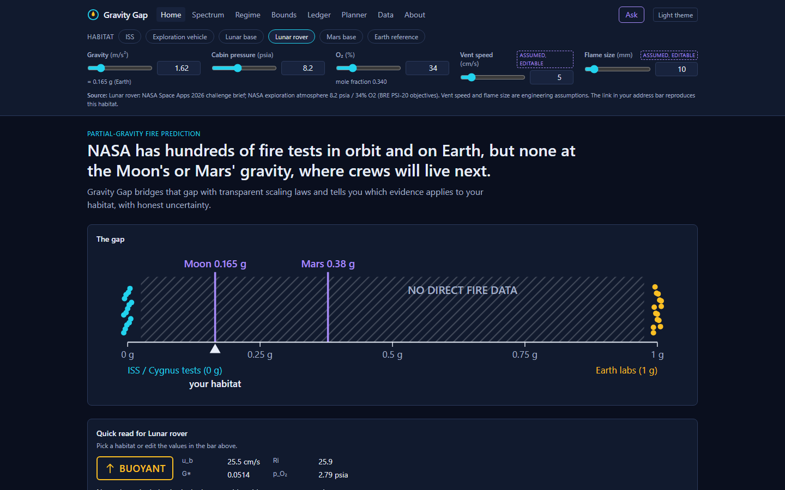

# Gravity Gap

**A partial-gravity fire prediction engine and dashboard** for the 2026 NASA Space Apps Challenge
(SI-powered fire safety dashboard for NASA microgravity combustion data).

> NASA has fire data from space and from Earth, but none from the Moon. Gravity Gap uses physics and 1,710 real
> PSI combustion tests to predict fire behavior where no one has tested, shows how sure it is (and refuses when there
> is no evidence), and tells NASA what to test next.


<sub>Screenshot generated by the E2E run into `docs/media/` (placeholder until it is committed).</sub>

## What it does
Pick a habitat (ISS, exploration vehicle, lunar base, lunar rover, Mars base, Earth, or custom gravity / pressure /
O₂ / vent speed) and every view updates:

| Feature | Page | What you get |
|---|---|---|
| F0 Habitat selector | header bar | Presets with sources; state in the URL (`?g=1.62&p=8.2&o2=0.34&u=10&L=10`, g in m/s²) |
| F1 Gravity spectrum map | `/explore` | Every PSI investigation on a 0–1 g axis, ranked for your habitat with visible score parts |
| F2/F3 Regime + pressure × gravity | `/regime` (`?tab=pressure`) | Buoyant velocity, Richardson number, forced / mixed / buoyant regime, G* heat map |
| F4 Bounds panel | `/bounds` (`?metric=M1..M5`) | Estimate, 90% band, 0 g / 1 g references, transfer confidence, sensitivity, evidence rows; "no evidence" when untested |
| F5 Prediction ledger | `/ledger` | Hash-committed, append-only predictions, re-verified in the browser |
| F6 Test planner | `/planner` | Top 10 tests for LUCI/FM2-style experiments + ventilation design implications |
| F7 Cards + Ask | `/investigations/[id]`, Ask drawer | PSI investigation cards and a grounded, citation-validated AI assistant |
| F8 Data explorer | `/data` | Filter the clean tests; CSV/JSON export with DOI citations |

Example (lunar base, 1.62 m/s², 8.2 psia, 34% O₂, vent 10 cm/s): the flame is in the **mixed** regime (Ri ≈ 6.48;
Monte Carlo 71.7% mixed / 28.3% buoyant), M1 = 0.20 with a 90% band [0.012, 0.684] and low transfer confidence, and
M2/M4/M5 return "no evidence" (`artifacts/bounds/lunar_base_M*.json`). The planner's top pick targets exactly that
atmosphere (`artifacts/planner.json`).

## Quickstart
Requirements: Python 3.13, Node 22.

```bash
# 1. API (from the repo root)
pip install -r requirements.txt
pip install -r requirements-ai.txt          # optional: live Claude answers when ANTHROPIC_API_KEY is set
python -m uvicorn api.main:app --port 8000  # docs at http://localhost:8000/docs

# 2. Web (second terminal)
cd web
npm ci
npm run dev                                 # http://localhost:3000 (copies artifacts first)
```

The web app reads `NEXT_PUBLIC_API_URL` (default `http://localhost:8000`). With the API stopped it falls back to the
precomputed artifacts for the six presets and shows an "offline data" chip. Without `ANTHROPIC_API_KEY`, Ask uses
validated cached or template answers. Docker and hosted deploys: [docs/DEPLOY.md](docs/DEPLOY.md).

## Tests
```bash
python -m pytest                 # engine, data quality, API, ledger, AI validator (repo root)
cd web && npm test               # vitest: physics parity, data layer, ledger hash, markdown safety
cd web && npm run lint
cd web && npx playwright install chromium && npm run e2e   # Playwright E2E: demo path online + offline, axe a11y
```
`npm run e2e` starts the API and `next start` itself (Playwright `webServer`); run `npm run build` first.
CI: [.github/workflows/ci.yml](.github/workflows/ci.yml).

## Rebuilding artifacts
Order matters (later steps hash or quote earlier ones):
1. **Engine artifacts:** `python -m engine.catalog`, `python -m engine.regime_grid`, `python -m engine.rules`,
   `python -m engine.bounds`, `python -m engine.planner`, `python -m engine.validation`, and (once DE lands it)
   `python -m engine.hindcast`
2. **AI cache:** `python -m engine.ai.answer --build-cache`
3. **Manifest (last):** `python scripts/build_manifest.py`, then `GET /health` must report `manifest_ok: true`.

`ledger/predictions.jsonl` is append-only: never rewrite existing lines.

## Repo map
```
api/            FastAPI app (api.main:app), schemas, API README
engine/         physics, presets, Monte Carlo, catalog, ranking, bounds models (M1–M3), rules (M4–M5),
                planner, validation, ledger, ai/ (context pack, validator, prompts, answers)
artifacts/      built outputs: catalog, regime grid, bounds/ (6 presets × 5 metrics), planner, rules,
                validation report, AI cache, MANIFEST
data/           PSI raw tables + metadata (sha256 manifest) and data/clean/ (clean tests, cleaning report)
ledger/         predictions.jsonl (append-only, hashed)
scripts/        fetch_psi, clean_psi_tables, seed_ledger, build_manifest, ledger append-only check
tests/          pytest suites + fixtures/physics_reference.json (shared with the web parity test)
web/            Next.js 15 app (app/, components/, lib/, e2e/)
docs/           SUBMISSION, DEMO_SCRIPT, DEPLOY, media/
plan/           engineering plan, contracts, decisions (ADRs), status
```

## Documentation
- Plan: start at [plan/00-overview.md](plan/00-overview.md); progress in [plan/STATUS.md](plan/STATUS.md);
  interfaces in [plan/contracts.md](plan/contracts.md); decisions in [plan/decisions.md](plan/decisions.md).
- Demo: [docs/DEMO_SCRIPT.md](docs/DEMO_SCRIPT.md) (2-minute and 30-second versions, offline fallback).
- Submission draft: [docs/SUBMISSION.md](docs/SUBMISSION.md).
- Deploy: [docs/DEPLOY.md](docs/DEPLOY.md).
- API: [api/README.md](api/README.md). Web: [web/README.md](web/README.md).
- Model validation: [artifacts/validation_report.md](artifacts/validation_report.md).
- Plan knowledge graph: `graphify-out/` (`graph.html`, `GRAPH_REPORT.md`; built with graphify from `plan/`).

## Limitations
No partial-gravity combustion data exist, so partial-g bands are a stated assumption, not a validated quantity.
Gravity does not move the droplet / burner estimates (M1–M3); it widens their bands and lowers confidence.
When a habitat atmosphere is far from every tested condition, the tool shows no number. This is decision support
for research prioritization, not a safety certification.

## Data, license and citation
Built on NASA **Physical Sciences Informatics (PSI)** combustion data, https://psi.nasa.gov, licensed **CC0-1.0**.
CC0 needs no attribution, but please cite the datasets: every investigation's DOI is in `artifacts/catalog.json`,
on the `/about` page and in every data export header (e.g. FLEX, PSI-69: https://doi.org/10.60555/mbq8-0451; ACME
CFI-G, PSI-159: https://doi.org/10.60555/cyt1-kh64; SAFFIRE-II, PSI-99: https://doi.org/10.60555/2chp-m469).
This project is not endorsed by NASA. Code license: **[verify: choose and add a LICENSE file]**.
